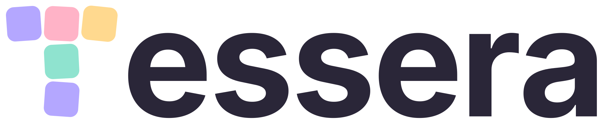
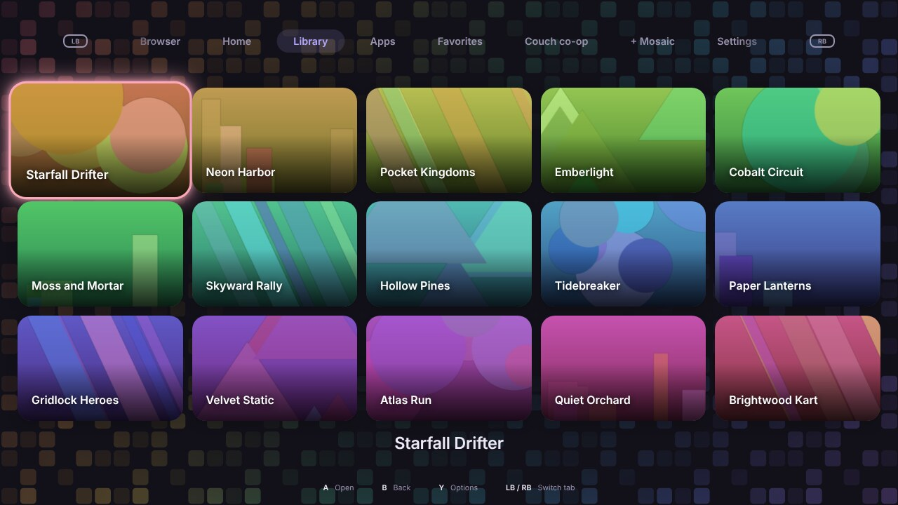
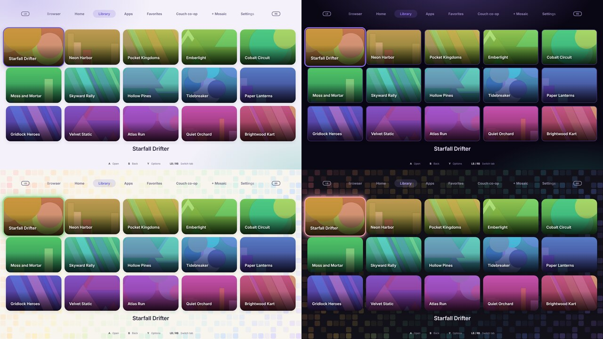
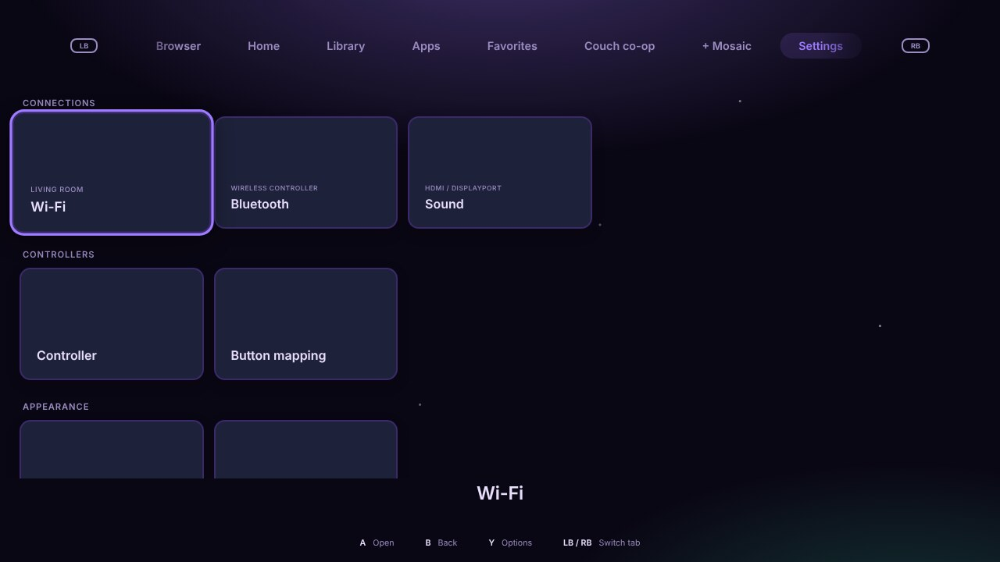
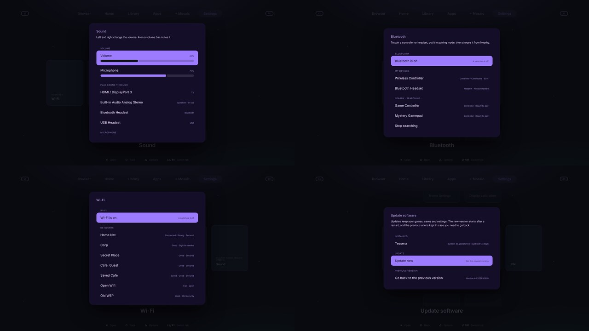
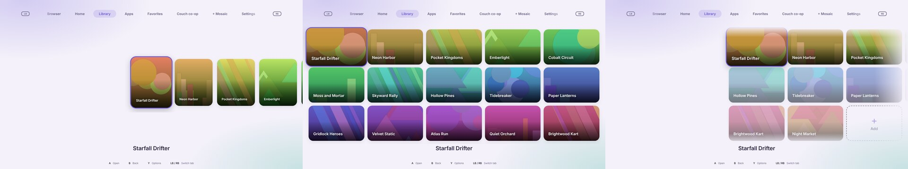

<div align="center">

<h1>
  &nbsp;
  <picture>
    <source media="(prefers-color-scheme: dark)" srcset="system_files/usr/share/tessera/branding/tessera-wordmark.svg">
    
  </picture>
</h1>

**A gaming OS you drive from the couch.**<br>
Controller-first, themeable down to the layout, built on [Bazzite](https://bazzite.gg).

[](https://github.com/Herbalchemist/tessera/actions/workflows/build.yml)


[Install](#install) · [Controls](#controls) · [Make it yours](#make-it-yours) · [Theming guide](docs/theming.md) · [How it's built](#how-its-built)



</div>

Turn the PC on and you're in a console-style launcher: pick a game, press A, play. Everything else a gaming PC needs (Wi-Fi, Bluetooth, sound, updates, storage) lives in the same controller-friendly Settings. A keyboard and mouse work just as well. The full KDE desktop is one menu away when you want it.

> **Status: early preview.** Tessera is a one-person project tested on one machine so far. It works, but expect rough edges, and keep a backup of anything you care about. Anything marked *Not yet* is planned, not built.

## Highlights

| | |
|---|---|
| 🎮 **Couch-first** | Every screen works with a controller: Xbox, PlayStation, Switch Pro and Joy-Cons, with button labels that match the pad in your hands. |
| ⌨️ **Keyboard & mouse too** | Hints switch to keycaps or *Click* the moment you touch a keyboard or mouse. Every key can be rebound, with layouts for WASD, H J K L and TV remotes. |
| 🧩 **Themes that change the layout** | Ten factory themes, and every part of the layout is a setting: where the menu sits, tile shape, clock, selection frame, the art behind everything. |
| 🏠 **The guide** | Press Guide from anywhere, even mid-game or on the desktop, for quick settings, controller batteries, profiles and power. |
| 🌐 **A real browser** | Full-screen pages with a stick-driven cursor, analog scrolling and trigger clicks. |
| 👋 **A friendly first run** | Setup asks who's playing, lets you pick a look with the launcher previewing live, and ends with an optional guided tour. |
| 🔒 **Family friendly** | An optional PIN guards Settings, deleting things and the browser. |
| 🕊️ **Yours** | No telemetry, no account, and Steam never starts unless you start it. |

## Ten looks out of the box



*Tessera Bright, Dark, Mosaic and Mosaic Dark; Arcade Marquee; and five homages to console home screens: Cartridge Pop, Nova Black, Dashboard Steel, Indigo Cube and Channel White. The homages echo layout, color and motion only; no console maker's logos, artwork or sounds are used.*

## Controls

The hints at the bottom of the screen always show the buttons for what you're holding, and every menu shows its own (select, back, and what Y does there) right under it.

| | Controller | Keyboard (Standard layout) | Mouse |
|---|---|---|---|
| Move | D-pad or left stick | Arrow keys (or the number pad) | Scroll wheel |
| Open / select | A | Enter or Space | Click |
| Back | B | Esc or Backspace | Right-click or the back thumb button |
| Options for a tile | Y (hold Y to pick a tile up and move it) | Y or the Menu key | Middle click |
| Switch tab | LB / RB | PgUp / PgDn, `[` / `]`, or Esc + ← / → | Click a tab, or the forward thumb button |
| The guide | Guide (Xbox / PS / Home button) | F1 or Home | |
| Volume | | Volume keys | |

A click outside a menu goes back, like Esc or a right-click (outside the on-screen keyboard, it cancels).

Every keyboard action can be rebound in **Settings › Keyboard & mouse**. Bindings follow the key's position, so they survive a change of keyboard layout, and the hints show what's actually printed on your keys. Pick a starting layout there:

- **Standard**: arrows.
- **WASD**: Q / E for tabs, Space to select.
- **H J K L**: for vim hands.
- **TV remote / media keys**: OK, Back, Home and the channel keys.

You can also keep the hints on controller buttons, or hide the pointer sooner or never.

**Nintendo controllers:** by default the bottom button confirms on every controller (so on a Switch pad, B opens and A goes back, by position). In **Settings › Controller › Confirm button** you can have Nintendo controllers follow their letters instead: A confirms and B goes back, with X and Y to match. It applies everywhere (menus, the browser, the on-screen keyboard), the hints follow it, and other controllers are never affected.

**Your own button layout:** in **Settings › Button mapping**, the face buttons and bumpers of the kind of controller you're holding (Xbox, PlayStation or Nintendo) can trade jobs: pick a job, press the button you want for it, and that button's old job moves to the one you replaced. Every job always stays on exactly one button, so you can't lose Select or Back, and **Put these buttons back** undoes it. Menus, hints, the on-screen keyboard and the browser all follow it.

**One Joy-Con on its own**, held sideways, works like it does on a Switch: the buttons turn with it (on a right Joy-Con, A at the bottom selects) and the hints use its own labels.

**The guide** (the Guide button) comes in three styles in **Settings › Controller › Guide style**: a panel from the side, a floating card, or compact. Notifications are part of each style (a panel beside the side guide, a card tucked behind the floating one, a strip inside the compact one): **X** hides or shows them, **Y** clears them.

**Bumping through tabs** never stalls on the browser: it only opens if you stay on its tab for a moment, and presses made while it's closing still count.

**The on-screen keyboard** comes docked (a compact panel in the middle) or wide (bigger keys across the whole screen): **Settings › Controller › On-screen keyboard**.

**Holding a direction** keeps moving, at the same pace in menus and the browser, whether it's the D-pad, the stick or the keyboard. Pick **Slower**, **Standard** or **Faster** in **Settings › Controller › Repeat speed**.

**The browser stays inside Tessera:** the page sits in a frame in your theme's colors, with the tabs either side, the page's address and title, and a loading light. **Y** pulls the address pill itself down out of the bar (its slot stays lit) and grows it into a big bubble for editing; the address starts selected, so typing replaces it, and plain words search DuckDuckGo. Done, it shrinks back into its slot. **Theme Settings › Browser › Address bubble** picks how it stays joined: a wide neck, a narrow tail, or detached (the tail snaps once it's open and reaches back down to take it home). Prefer the page edge to edge? **Theme Settings › Browser frame › Full screen**.

**In the browser:** the right stick moves a cursor and the left stick scrolls, both faster the further you push. RT clicks and LT right-clicks, Y types an address, X jumps to the next link, and LB / RB or B leave the page. Swap the sticks or change their speed in **Settings › Controller**.

## What you get

**A launcher made for a controller**
- Tabs: Browser, Home, Library, Apps, your own *mosaics* (tabs you build yourself) and Settings.
- **Home** is a page of widgets: a clock, recently played, six system widgets (CPU, Memory, Storage, Battery, Network, Uptime) and community widgets from Add-ons.
- Add games from Steam, Lutris, Heroic and installed apps with one scan, or pick them from your folders. Box art is found automatically and can be replaced per game.
- **The guide**: press Guide from anywhere, even in the middle of a game, for:
  - what's running (resume or close it);
  - volume, Wi-Fi and Bluetooth;
  - controller batteries and profiles;
  - recent notifications and power;
  - *Take the tour*.

  Holding Guide goes straight Home (swap press and hold in *Settings › Controller*). In Desktop Mode the same guide comes up over the desktop with *Return to Tessera*. It steps aside while Steam is running, since Steam takes the button for itself.
- **First-run setup**: who's playing (a profile), pick a look with the whole launcher previewing behind it, an optional PIN, and an optional **guided tour** that lights up each part of the screen in turn and lets you try it: switch tabs with the bumpers, add a widget to Home, link a library drive or folder, and make your own tab, each right from its step.
- An on-screen keyboard (with a symbols layer) for names and passwords, and a keypad for the PIN. With a real keyboard you just type.
- Nintendo Switch Pro Controllers and Joy-Cons work in the launcher. Two Joy-Cons can be one controller or two players, switched like on the Switch (*Change grip/order*), and the controller test shows their motion sensors.

**Settings that don't need a keyboard**

| Group | What's inside |
|---|---|
| Connections | **Wi-Fi** (join with the on-screen keyboard, password hidden unless you press Show, hidden networks, forget), **Bluetooth** (pair controllers and headsets), **Sound** (volume, microphone, output, headset mode) |
| Controllers | **Controller**: live test, Guide button, button mapping, dead zones, rumble, button labels, browser cursor and scroll. **Keyboard & mouse**: key layouts, every key rebindable, hint style, pointer and scroll wheel |
| Appearance | Theme settings, profiles, display calibration |
| System | **Storage** (drives, clean-up, backups), **Update software** (with *go back to the previous version*, and switching builds after a graphics card swap), Add-ons, PIN |
| Power | Sleep, restart, shut down, Desktop Mode |





## Make it yours

- **Theme Settings** changes everything from the couch: screen area, text size, colors, corners, borders, background picture or effect, widget style, motion, and the browser's entrance animation (slide, zoom, fade, rise, flip, doors or none).
- **Shell arrangement** is a layout preset rather than a color swap: **Classic**, **Bottom dock**, **Crossbar**, **Dashboard**, **Home row**, **Spotlight**, **Pivot**, **Cube** and **Channels**.
- **Layout parts** let you pick each piece on its own, every one with an *Auto* option that follows the arrangement:
  - menu position and tab look;
  - clock and selection frame;
  - where the name goes;
  - tile shape, size and look;
  - how rows move;
  - the selection's art behind everything;
  - an emblem;
  - where the button hints sit.

  So round icon buttons and a curved clock bar can sit over spotlight art.
- **Three tile layouts**: **Rails** (sideways rows), **Grid** and **Flow**, in ready-made sizes or your own (up to 12 columns).
- **Your own themes**: *Save current as a new theme…* writes a `theme.json` you can rename, overwrite, share or hand-edit. Factory themes stay read-only. A theme is values only, never code, so nothing it ships can do more than Settings itself already allows.
- **Profiles**: everyone in the house gets their own setup: their own controls and button layout, keyboard keys, Home and mosaics, Recently played, browser logins and theme. Games are installed once and shared. A new profile starts as a copy of the shared setup or from scratch; switch from the guide or *Settings › Profiles*, and Tessera can ask *Who's playing?* when it starts. Removing a profile deletes what was theirs. Stick calibration stays with the controller, and the PIN, Wi-Fi, storage and add-ons belong to the machine.
  - **Profile PINs**: anyone can have a PIN of their own, for logging in as them and for their own things (their browser, asked again after a few minutes). It never grants admin rights: Settings, adding and deleting still need the admin PIN, and the admin PIN opens any profile. The **admin profile** logs in with the admin PIN, or with a separate login PIN of its own (then the admin PIN is asked whenever admin rights are needed). After a restart nobody is logged in: Tessera asks who's playing. **Guest** is Tessera with nobody's profile. Once anyone has a profile, Guest is locked down to playing games until the admin allows more in *Settings › Profiles* (press Y on Guest): apps, the browser, changing Home and the mosaics, the look, the controls, and whether Guest is offered in *Who's playing?* at all. The admin PIN allows anything else on the spot. With no profiles, nothing is restricted. Five wrong guesses make a profile's login wait a while (never more than 5 minutes); the admin PIN never waits, and skips and clears any profile's wait. Forgot a profile PIN? The admin removes it in *Settings › Profiles*.
- Display calibration for the launcher and, optionally, for games.

📘 **[The theming guide](docs/theming.md)** covers every setting a `theme.json` can hold, how the layout parts combine, worked examples, and a checker that tells you what Tessera will accept before you copy a theme over.



## Add-ons

**Settings › Add-ons › Get add-ons** lists optional extras from [tessera-addons](https://github.com/Herbalchemist/tessera-addons), installed with one press. Nothing there is forced on anyone.

- **Shards** are add-ons that are code. Installing one never turns it on: in **Add-ons › Shards**, pick it and choose **Turn on**. A shard adds a page of its own under Shards, and it can add games to **Find games**.
- **Official** means the Tessera project signed that shard's exact files. Tessera checks the signature every time the shard starts. **Shard safety** decides whether unverified shards may run at all, and whether turning shards on or off needs the PIN.
- The first shard is **Xbox PC Games Setup**. It helps you set up software to play Xbox PC games you own, and shows which ways this machine can really do it (Xodus Nexus on Linux, Xbox Cloud Gaming, streaming, a Windows VM with its own graphics chip, or Windows on its own drive) and what each still needs. It only looks, and changes nothing. You need your own games and accounts; it isn't made by or affiliated with Microsoft.
- Games other launchers add to Steam (Steam's "non-Steam games", which is where Xodus Nexus puts its own) now show up in **Find games** too.

## Install

There are two ways to get Tessera.

### Option A: the Tessera USB (new, in testing)

A bootable USB that installs Tessera with **no internet needed**, on any PC Bazzite supports. You don't need Bazzite first, or to pick the right version for your graphics card: the USB carries every build and picks the one for the machine it's installing to.

1. Make the USB with **[Tessera Mortar](https://github.com/Herbalchemist/tessera-mortar#make-a-tessera-usb-with-mortar)**, a small app for Windows and Linux. Pick a USB drive of 32 GB or more; Mortar downloads the newest Tessera USB image, checks it, writes it and checks the drive.
2. Boot the PC from the USB. It starts into **Install Tessera**, which works with a controller, a keyboard or a mouse:
   - Choose **Try it first** to look around, or **Install Tessera** to go ahead.
   - Pick the disk. It's erased completely, and the USB itself is never offered.
   - The graphics build is already picked for this PC.
   - Set your name and password, and your time zone.
   - Choose **Set it up for me** for Secure Boot, or **I'll handle it**.
3. After the install, restart and take the USB out. If you chose Secure Boot setup, a blue screen asks once to confirm the key: choose *Enroll MOK*, then *Continue*, then *Yes*, type `universalblue` and choose *Reboot*. The install screen walks you through it.
4. Tessera starts with its first-run setup and an optional tour. Updates come through *Settings > Update software* as usual.

> The USB has passed a full install in a virtual machine and is now being tested on real hardware. Use a spare disk until it's out of testing.

### Option B: switch an existing Bazzite install

Tessera is an image of Bazzite with the Tessera session on top, so you can start from a Bazzite install and switch to Tessera with one command. Your games, saves and settings stay where they are.

**You need**
- A PC running the current **Bazzite** (install it from [bazzite.gg](https://bazzite.gg); the [Bazzite docs](https://docs.bazzite.gg) cover that part).
- **AMD or Intel graphics** use the standard image below.
- **NVIDIA: experimental, not yet tested on real hardware.** Bazzite supports NVIDIA through separate images that include NVIDIA's driver, and Tessera now builds a matching image for each. Only switch if you're happy to help test, and keep your previous version to go back to.

  | Your card | Bazzite image | Tessera image |
  |---|---|---|
  | AMD or Intel | `bazzite` | `ghcr.io/herbalchemist/tessera:latest` |
  | NVIDIA GTX 16-series or any RTX (Turing and newer) | `bazzite-nvidia-open` | `ghcr.io/herbalchemist/tessera-nvidia-open:latest` |
  | NVIDIA GTX 900 / 1000-series (Maxwell, Pascal, Volta) | `bazzite-nvidia` | `ghcr.io/herbalchemist/tessera-nvidia:latest` |

  Never switch an NVIDIA machine to the standard `tessera` image: it has no NVIDIA driver.

**Changed your graphics card?** You don't reinstall anything. Tessera notices the new card shortly after it starts and offers to switch to the build made for it (it's also in *Settings › Update software › Graphics*). Switching works like an update: it downloads, starts after a restart, and keeps every game, save and setting. The old build stays in the boot menu. From a terminal, `sudo tessera-fix-graphics` does the same.

**Switch to Tessera**

```bash
sudo bootc switch ghcr.io/herbalchemist/tessera:latest   # or tessera-nvidia-open / tessera-nvidia, from the table above
systemctl reboot
```

After the restart the machine signs in to Tessera by itself.

**Update**: in Tessera, open *Settings > Update software*. Or, from a terminal: `sudo bootc upgrade`, then restart. An update starts after a restart and the old version is kept.

**Go back**
- In Tessera: *Settings > Update software > Go back to the previous version*, then restart. Right after your first switch, the previous version is your Bazzite.
- Or pick the previous entry in the boot menu.
- Or return to stock Bazzite for good: `sudo bootc switch ghcr.io/ublue-os/bazzite:stable` (on NVIDIA, `bazzite-nvidia-open:stable` or `bazzite-nvidia:stable`), then restart.

**Desktop Mode**
- In Tessera: *Settings > Power > Desktop Mode*. You land on the login screen, so you need your account password; choose the desktop session there.
- To come back, open *Return to Tessera* in the application menu. It asks first, then closes the desktop (your open programs ask to save their work) and starts Tessera, so nothing of the desktop is left running. Or log out and pick *Tessera* at the login screen.
- If automatic sign-in is switched off, or someone else is signed in, *Return to Tessera* opens Tessera on top of the running desktop instead and closes nothing. *Open Tessera on top of the desktop* in the application menu does that on purpose.
- Prefer to boot to the desktop? `sudo touch /etc/tessera/no-autologin`, then restart. Delete that file to turn it back on.

**Forgot the PIN?** From Desktop Mode, run `tessera-reset-pin` in a terminal. It removes the PIN so you can set a new one.

## Good to know

- **Steam never starts by itself.** Tessera starts programs only when you pick them, and it doesn't wrap games in a sandbox.
- **No telemetry.** The launcher makes no network requests of its own: its pages can't (their content-security policy forbids it), and the only thing it fetches is the add-on list and packages, when you open Get add-ons. Updates are fetched by the system's own `bootc` tool. GitHub signs every Tessera image, and the system carries the key that checks those signatures.
- **Browser permissions:** the embedded browser is isolated from the launcher and currently denies camera, microphone, location, notifications and other permission requests. A controller-friendly website-permission prompt is not built yet. Typing into a page's own text fields with the on-screen keyboard is not built yet (the address bar works).
- **Not yet:** Bluetooth keyboards that ask you to type a code, enterprise (802.1X) and WEP Wi-Fi, parental controls beyond the PIN.

## Reporting a problem

*Settings › Report a problem* (or *Help* in the guide) writes a text file about the machine and Tessera's recent logs to `~/Tessera/Reports`: the Tessera build, the system, the hardware (processor, memory, graphics card and driver, screens, controllers by name), how it starts up, Tessera's logs and the login screen's log, and the settings that change how things work. It is **not telemetry**: nothing is sent anywhere. It is made only when you ask, you can read every line on screen first, and you choose whether to attach it to an [issue](https://github.com/Herbalchemist/tessera/issues). PINs, passwords and Wi-Fi names are never in it, and your account and computer names, network and hardware addresses and e-mail addresses are replaced with `[brackets]`.

## Roadmap

- A freeform, drag-and-drop layout editor, and a separate theme creator app.
- Typing into a web page's own text fields with the on-screen keyboard, and a controller-friendly prompt for website permissions.
- Profiles: limits for younger players (which games and pages they see, play time).
- NVIDIA builds: test on real hardware and drop the *experimental* label.
- Controllers on real hardware: a single Joy-Con held sideways (left and right), a Switch Pro Controller and Joy-Cons with **Confirm button** set to "A confirms" and with a remap (0.28 fixes them being swapped twice in the launcher's menus), and an Xbox and a PlayStation controller remapped in the browser.
- Wi-Fi: hand the password to NetworkManager without putting it on `nmcli`'s command line, where other accounts on the machine can briefly see it while it joins. Needs a test on real Wi-Fi before it ships.
- Before 1.0.0: Tessera's own wallpapers and other content, enough to stand on its own; then Bazzite's wallpapers come out. Until then they stay as they are, beside Tessera's.

## How it's built

- `Containerfile`: starts from `ghcr.io/ublue-os/bazzite:stable` and adds Tessera.
- `system_files/`: files copied into the image. The launcher is plain Electron + HTML/CSS/JavaScript in `system_files/usr/lib/tessera/launcher`, run inside [Gamescope](https://github.com/ValveSoftware/gamescope) by `tessera-session`. Its main process is split into parts in `main/` (library, settings, themes, add-ons, shards, updates, the browser and so on; `main.js` lists them in load order), and the page into `renderer/` (`index.html` loads them in order).
- `build_files/build.sh`: the image build steps. `build_files/branding.sh` puts Tessera's name and look over Bazzite's: the boot menu, About this system, the logos, splash, wallpaper and lock screen, the terminal banner, and the computer's name. Under the hood the system still identifies as Bazzite to Bazzite's own tools. Every logo file is drawn by `tools/branding/make-logos.py` and `render.cjs`, so they stay alike.
- GitHub Actions builds the image and publishes it to `ghcr.io/herbalchemist/tessera`. This repo started from the [Universal Blue image template](https://github.com/ublue-os/image-template).
- Want your own spin? Fork the repo, enable Actions, and `bootc switch` to your fork's image.

**Theme checker**: `node tools/check-theme.cjs path/to/theme.json` (see [the theming guide](docs/theming.md)).

**Launcher checks** (Node.js required):

```bash
npm --prefix system_files/usr/lib/tessera/launcher run check
npm --prefix system_files/usr/lib/tessera/launcher test
```

These checks cover deterministic input/theme logic, not real controller hardware or a booted Bazzite image. See `docs/tessera-review-and-fixes.md` for the patch assessment and remaining design work.

Bug reports and ideas are welcome as GitHub issues.

## License and credits

Tessera is free software, licensed under the **GNU General Public License v3.0** (see `LICENSE`).

Tessera is built on Bazzite and shows its own name and logo; *About this system* says "Built on Bazzite". It stands on the shoulders of [Bazzite](https://bazzite.gg), [Universal Blue](https://universal-blue.org), Fedora, [Gamescope](https://github.com/ValveSoftware/gamescope) and [Electron](https://www.electronjs.org). Tessera is an independent project and is not affiliated with or endorsed by any of them. Product and brand names are the property of their owners.
