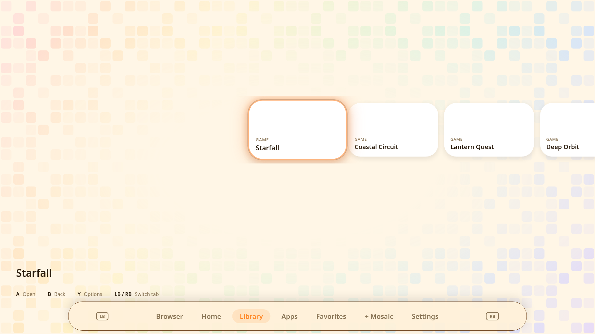
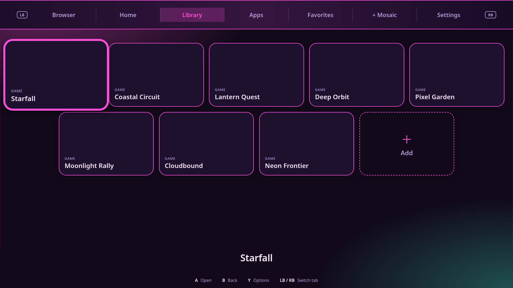
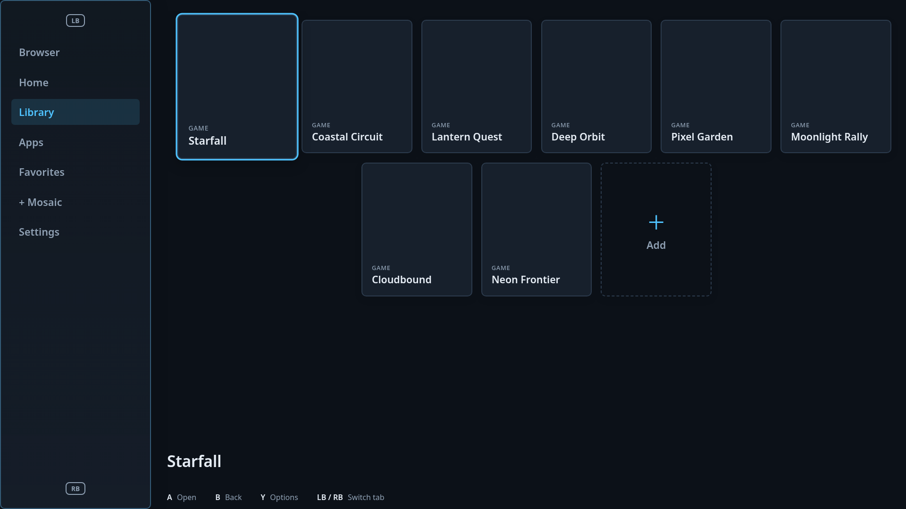

Tessera is worth improving rather than restarting. Bazzite plus Gamescope and an Electron launcher is a reasonable foundation for your console-like OS. The main obstacle is that controller behavior and visual layout are tightly coupled to a large, fixed launcher implementation. Your customization concern is justified: the original themes can change colors, shapes, density and Rails/Grid/Flow, but they cannot compose a substantially new interface from reusable regions and components. [1] [2]

This review inspected commit `5c90ce3663ff87b12c5fc508ee455fc97e1e1b45` and produced an incremental, tested source patch. **Nothing was pushed to GitHub, deployed, rebased onto your PC, or published as an OS image.** The deliverable is modified source, not a hardware-certified release.

Author: Manus AI · Review date: October 25, 2026.

## Browser problems fixed

Two defects could prevent the generic Linux controller reader from recognizing a pad at all. The scanner used regular expressions that matched a literal backslash instead of normal names such as `js0` and `event0`. It also tried to parse a complete sysfs capability mask as one hexadecimal number, although Linux prints these masks as space-separated machine words. The patch fixes both and adds realistic multiword fixtures. [3] [4]

The embedded browser also had incomplete input ownership. Nintendo frames were consumed in the main process instead of reaching the renderer, but the browser-close callback used for external browsers was not installed for the embedded view. Bumpers, Back and address entry therefore did not have a reliable route back to Tessera. The patch introduces a narrow `browser-action` event for those commands and connects it to the renderer. It suppresses duplicate native renderer dispatch while the main process owns browser input, and guards against opening the address keyboard twice. [5]

A real Electron test exposed another defect: sending Enter key-down and key-up reaches web-page listeners but does not activate a focused HTML button. The patched event helper includes the character event needed for native activation. The new focus-next action sends Tab, so keyboard-accessible links and fields can be reached with a controller instead of relying on the mouse.

Browser directions now repeat while held, with a 350 ms initial delay and 90 ms repeat interval. Repeat timers are cleared on release, view detachment and controller removal. The browser view is explicitly focused on attach/load. Raw evdev and virtual Nintendo frames now use the same positional confirm/cancel/focus/address contract as the launcher; printed Nintendo letters are not treated as Xbox letters.

The browser controls, expressed as Xbox-style launcher roles, are:

- **A / bottom face button:** activate the focused web control.
- **X / left face button:** focus the next keyboard-accessible link or field.
- **Y / top face button:** open Tessera's address/search keyboard.
- **B / right face button:** exit the browser to Tessera, not website history-back.
- **LB / RB:** exit and switch to the neighboring launcher tab.
- **D-pad / left stick:** arrow navigation. **Right stick:** page-navigation keys, including Page Up/Down for vertical movement.

For Nintendo pads, these positional roles correspond to printed B, Y, X and A respectively. This preserves the launcher's current positional convention. A future input-profile setting should let users choose Nintendo-style confirm/cancel semantics consistently throughout the OS.

This is not yet a universal controller browser. Mouse-only websites, arbitrary page-field typing with an on-screen keyboard, directional link selection, and a controller-driven web pointer still need work. The generic native reader still depends on suitable `js*`/`event*` devices and permissions. USB/Bluetooth behavior must be checked on your actual Bazzite/Gamescope session.

## Themes now change structure

The patch adds a validated `shellLayout` choice to Theme Settings. Old themes default to Classic, and saved custom themes preserve the chosen arrangement through the existing JSON/settings pipeline.

**Cartridge Pop now uses a bottom dock and compact horizontal card strip.** The dock is constrained to the calibrated screen area, and controller hints remain visible at 720p rather than being hidden to make space.



**Arcade Marquee now uses a full-width category crossbar above vertically organized content.** It is structurally different from the original centered pill-tab header.



**Dashboard Steel now uses a left category sidebar and a separate wide content pane.** Up/down moves through the sidebar; right enters content, and left from the content edge returns to the sidebar.



The screenshots are captures of the running patched launcher with fictional QA game titles and no downloaded box art. They are not rendered concept images or claims about your installed library.

Classic/Crossbar retain top-navigation handoffs, Dock uses up/down handoffs, and Dashboard uses right/left handoffs. The patch does not rewrite Home widget coordinates or alter your library when the shell changes. A small shared `shell-layout.js` contract defines these rules instead of scattering unvalidated theme names throughout the renderer.

You can select the arrangement through **Settings → Theme Settings → Layout → Shell arrangement**, or use a custom theme:

```json
{
  "name": "My Dashboard",
  "author": "You",
  "defaults": {
    "shellLayout": "dashboard",
    "layout": "grid",
    "gridPreset": "c4r2",
    "accent": "#71d6a3"
  }
}
```

Place it at `~/Tessera/Themes/my-dashboard/theme.json` on an ordinary installation, then reload Add-ons. A fuller working example is included at `examples/themes/my-dashboard/theme.json`. When `TESSERA_DATA_DIR` is overridden for testing, the vault is under that test data directory unless explicitly overridden.

**These presets are a first structural step, not the complete “create whatever is in your head” system.** You can choose and customize approved arrangements; you cannot yet draw an arbitrary composition or supply your own component templates. The patch deliberately keeps themes data-only rather than solving flexibility by granting downloaded themes executable access.

## The design needed for your full vision

Keep the Linux base and existing renderer. Refactor around two contracts before building more screens.

First, establish one semantic **action router**. Every controller, keyboard and mouse adapter should produce actions such as Confirm, Cancel, Move, NextTab and OpenAddress, with explicit press/release/repeat information. A context stack should decide whether the shell, a dialog, the on-screen keyboard, a layout editor or the browser receives them. This replaces the current collection of renderer globals and separate browser/Nintendo interception rules. [6]

Second, turn themes into a versioned **declarative layout specification**. It should describe approved regions, component variants, data bindings and navigation edges, not just CSS variables. A user could place navigation on the left, assign a hero panel to the selected game, add a horizontal recent-games rail, and dock system widgets elsewhere without changing launcher JavaScript. A component catalog can expose grid, rail, list, hero, clock, status and command-bar elements while retaining a safe import format.

Visual layout and controller navigation must be specified together. Every interactive component needs a stable identity and a route back to the rest of the interface. Reject themes with unreachable controls, missing exit routes or invalid references. Offer contrast/focus warnings and a known-good fallback if a theme cannot load. That is what makes customization suitable for a controller-first OS rather than merely flexible CSS.

Build a **controller-friendly layout editor** over the same validated specification: draft preview, move/resize/swap, undo/redo, and Apply/Cancel before persisting. Store a profile's library, layout preferences and theme choice separately enough that importing a look never overwrites their games or Home arrangement. Ship three genuinely different example compositions as demonstrations of the component system, not only presets that require new hardcoded CSS for every additional look.

The patch intentionally does not attempt that whole refactor in one pass. The practical next milestone is the shared action/context router and a small region-based layout schema, followed by an editor for those regions.

## Other risks that still need attention

**Backup restore is not transactional across both JSON files.** The baseline writes the library and settings separately. If the second write fails, the first may already have changed even though the error message says the previous setup was left intact. This is not fixed here. Use a staged state generation plus an atomic manifest swap, or a journal with rollback, and test failed writes before treating restore as all-or-nothing. [7]

**The installer workflow needs repair before advertising direct ISO installation.** It references `disk_config/iso.toml`, which is absent from the inspected tree. The supplied GNOME/KDE templates also contain a post-install switch to `ghcr.io/ublue-os/image-template:latest`, not Tessera. Do not simply rename one and assume it is safe. Select the intended installer configuration and image target, then validate the produced image in a VM. These issues are not fixed by this launcher patch. [8] [9]

**Release reproducibility is incomplete.** The Electron version is pinned, but production dependencies are installed during image construction without a committed production lockfile, and base/builder images use moving tags. Preserve intentional Bazzite updates, but record the dependency graph and promote tested immutable image digests. The optional QA dependencies now have their own pinned versions and lockfile; that does not solve production image reproducibility. [10]

**Privileged policy belongs in the main process.** This patch validates browser IPC sender/main-frame identity and checks the PIN for open/go/show. The browser uses a separate persistent session, no preload bridge, Node disabled, and default-deny permissions. Camera, microphone, location, notifications and other permission-dependent site features will not work until a consent UI exists. Existing browser cookies in the old default session are not migrated to the new partition, so users may need to sign in again. Apply the same sender/capability discipline to the remaining IPC services over time. [11]

## What was actually validated

All **17 Node regression tests pass**, and launcher JavaScript syntax checks pass. Coverage includes real Linux node names, capability word parsing, standard controller roles, held navigation, safe web destinations, Enter event sequencing, structural preset validation and focus-handoff contracts. The existing image-build workflow now checks every launcher JavaScript module instead of only two files.

The combined launcher passed **23 Electron 44.9.0 integration checks** with isolated temporary data. Those checks include four layouts at 1280×720 and 1920×1080, selected-card/controller-hint visibility, Home/Settings content preservation, saved structural-theme values, virtual D-pad polling, actual browser Tab/Enter activation, address-keyboard cancellation, browser Back/bumper exit and independent main-process PIN enforcement. No renderer errors were recorded. The theme workstream also exercised Theme Settings and on-screen keyboard interactions in the real Electron UI.

The harness uses a test-only `--no-sandbox` launch flag in the container environment. It verifies configured isolation/sandbox settings and absence of a remote preload bridge, not the operating system's enforcement of Chromium sandboxing. It loads a local HTTP test fixture rather than logging into public websites.

**Not validated:** physical controllers, Bluetooth pairing/hotplug, joystick permissions, Gamescope focus behavior, suspend/resume, a built OS image, autologin, system-service changes, or bootc update/rollback. A successful UI test is not evidence that those layers work.

## Apply and try the changes safely

Use the source archive as a reviewable working copy, or apply `tessera-improvements.patch` to a clean clone based on the inspected commit. The patch includes source, tests, QA tooling, documentation, an example theme and the screenshot files. It has not been committed or published upstream.

```bash
git clone https://github.com/Herbalchemist/tessera.git tessera-review
cd tessera-review
git switch -c fix/controller-and-structural-themes 5c90ce3
git apply --check /path/to/tessera-improvements.patch
git apply /path/to/tessera-improvements.patch
npm --prefix system_files/usr/lib/tessera/launcher run check
npm --prefix system_files/usr/lib/tessera/launcher test
```

For optional Linux desktop/headless Electron tests, follow `qa/README.md`. That harness creates its own temporary library and settings; it does not use your real data or launch a game.

Before building or rebasing a personal image, test your actual controller on a non-production launcher copy. Check address entry, focus-next, activation, both exits, held directions, disconnect/reconnect, and return from the keyboard. Record the controller model and whether it uses USB or Bluetooth. Also try all shell arrangements with your real Home widgets and TV calibration. Keep your current OS image available for rollback. **Running `bootc upgrade` against the existing public image will not install these unpublished source changes.**

## References

[1]: https://github.com/Herbalchemist/tessera/tree/5c90ce3663ff87b12c5fc508ee455fc97e1e1b45 "Tessera inspected source tree"
[2]: https://github.com/Herbalchemist/tessera/blob/5c90ce3663ff87b12c5fc508ee455fc97e1e1b45/system_files/usr/lib/tessera/launcher/main.js#L654-L799 "Original theme schema and factory defaults"
[3]: https://github.com/Herbalchemist/tessera/blob/5c90ce3663ff87b12c5fc508ee455fc97e1e1b45/system_files/usr/lib/tessera/launcher/main.js#L3720-L3757 "Original generic controller discovery"
[4]: https://raw.githubusercontent.com/torvalds/linux/master/drivers/input/input.c "Linux input capability bitmap formatting"
[5]: https://github.com/Herbalchemist/tessera/blob/5c90ce3663ff87b12c5fc508ee455fc97e1e1b45/system_files/usr/lib/tessera/launcher/main.js#L3220-L3289 "Original Nintendo browser interception"
[6]: https://github.com/Herbalchemist/tessera/blob/5c90ce3663ff87b12c5fc508ee455fc97e1e1b45/system_files/usr/lib/tessera/launcher/renderer.js#L4008-L4247 "Original renderer input routing and gamepad loop"
[7]: https://github.com/Herbalchemist/tessera/blob/5c90ce3663ff87b12c5fc508ee455fc97e1e1b45/system_files/usr/lib/tessera/launcher/main.js#L2705-L2750 "Original two-file backup restore"
[8]: https://github.com/Herbalchemist/tessera/blob/5c90ce3663ff87b12c5fc508ee455fc97e1e1b45/.github/workflows/build-disk.yml#L80-L89 "Installer workflow configuration reference"
[9]: https://github.com/Herbalchemist/tessera/blob/5c90ce3663ff87b12c5fc508ee455fc97e1e1b45/disk_config/iso-kde.toml "Installer template post-install image target"
[10]: https://github.com/Herbalchemist/tessera/blob/5c90ce3663ff87b12c5fc508ee455fc97e1e1b45/build_files/build.sh#L22-L62 "Production Electron installation during image construction"
[11]: https://www.electronjs.org/docs/latest/tutorial/security "Electron security guidance for remote content, permissions and IPC"
